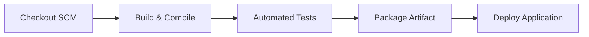

# Pipeline as Code Specification (Jenkinsfile)

**Project:** Smart Irrigation Alert Dashboard  
**Student:** Chetan Katkar | **Roll No:** 23102A0024 | **Class:** BE CMPN-A  

---

## 🛠️ Pipeline Architecture & Stages

### Parameters Configured:
- `DEPLOY_ENV`: Choices `staging` or `production`
- `APP_PORT`: Default `8085` (avoids Jenkins port 8080 collision)

### Stages Executed:
1. **Stage 1: Checkout SCM** — Clones latest commit from GitHub repository.
2. **Stage 2: Build & Compile** — Runs `mvn clean compile` to compile all source classes.
3. **Stage 3: Automated Tests** — Executes `mvn test` and publishes JUnit XML test reports.
4. **Stage 4: Package Artifact** — Assembles standalone executable Spring Boot JAR file and archives in Jenkins.
5. **Stage 5: Deploy Application** — Deploys application to target port and validates health endpoint.
