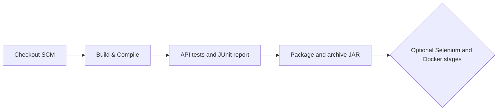

# Pipeline as Code Specification (Jenkinsfile)

**Project:** Smart Irrigation Alert Dashboard  
**Student:** Chetan Katkar | **Roll No:** 23102A0024 | **Class:** BE CMPN-A  

---

## 🛠️ Pipeline Architecture & Stages

### Parameters Configured:
- `RUN_SELENIUM`: Defaults to false; requires Chrome/Chromium or Selenium Grid.
- `DEPLOY_DOCKER`: Defaults to false; requires Docker daemon access for Jenkins.
- `DEPLOY_PORT`: Defaults to `8087` for the Jenkins-managed demo container.

### Stages Executed:
1. **Stage 1: Checkout SCM** — Clones latest commit from GitHub repository.
2. **Stage 2: Build & Compile** — Runs `mvn clean compile` to compile all source classes.
3. **Stage 3: Automated Tests** — Executes `mvn test` and publishes JUnit XML test reports.
4. **Stage 4: Package Artifact** — Assembles standalone executable Spring Boot JAR file and archives in Jenkins.
5. **Stage 5: Selenium UI Tests** — Optional browser tests run with `mvn -Pselenium verify`.
6. **Stage 6: Docker Build and Deploy** — Optional local image build, container health check, and rollback attempt. It is not run until `DEPLOY_DOCKER` is enabled.

The earlier pipeline screenshot showed build #2 succeeding for the previous Jenkinsfile revision. Run the updated pipeline after pushing these changes to verify the new Jenkinsfile on the machine.
