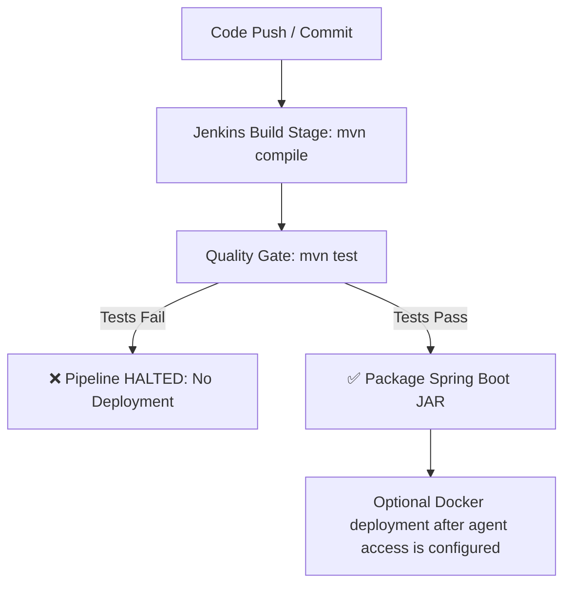

# Continuous Testing & Quality Gate Specification (Task 10)

**Project:** Smart Irrigation Alert Dashboard  
**Student:** Chetan Katkar | **Roll No:** 23102A0024 | **Class:** BE CMPN-A  

---

## 🛡️ Quality Gate Workflow in Jenkins Pipeline

The automated test suite acts as an enforced **Quality Gate** between the build and deployment phases.

---

## Current test evidence

The current suite contains five Spring MockMvc API tests. Jenkins build #2 reported all five passing, published the JUnit report, and archived the packaged JAR.

Five Selenium UI tests are now included under `mvn -Pselenium test`. They cover dashboard load, crop search, critical-status filtering, zone creation, and irrigation recovery. They are optional in Jenkins until Chrome/Chromium or a Selenium Grid is available on the agent; enable `RUN_SELENIUM` after that setup.

No defect-injection/failure screenshot is recorded as completed evidence in this repository. For the demo, retain the actual failed build and its console/test report if you perform that exercise.
