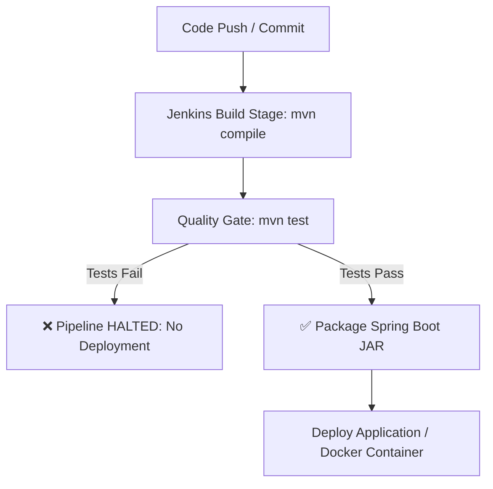

# Continuous Testing & Quality Gate Specification (Task 10)

**Project:** Smart Irrigation Alert Dashboard  
**Student:** Chetan Katkar | **Roll No:** 23102A0024 | **Class:** BE CMPN-A  

---

## 🛡️ Quality Gate Workflow in Jenkins Pipeline

The automated test suite acts as an enforced **Quality Gate** between the build and deployment phases.

---

## 🔍 Defect Injection & Recovery Cycle

1. **Defect Introduction:** A bug was simulated in `SensorZone.java` where threshold comparison was inverted (`moistureLevel > 30` instead of `< 30`).
2. **Automated Quality Gate Failure:** Jenkins ran `mvn test`. Test case `TC-02: Verify critical alert detection` failed with `AssertionError`.
3. **Pipeline Protection:** Deployment stage was automatically skipped, protecting staging/production environments from regression.
4. **Defect Resolution:** Threshold restored to `< 30.0`. Fixed code pushed with message `fix: correct moisture threshold comparison logic`.
5. **Rerun Success:** Pipeline rerun executed all 5 tests successfully and proceeded to packaging and deployment.
