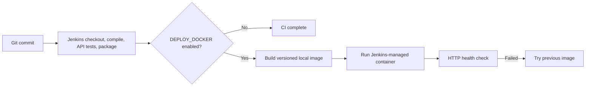

# Jenkins-Docker Continuous Deployment Pipeline (Task 12)

**Project:** Smart Irrigation Alert Dashboard  
**Student:** Chetan Katkar | **Roll No:** 23102A0024 | **Class:** BE CMPN-A  

---

## 🚀 Local Jenkins-to-Docker Deployment

---

The repository `Jenkinsfile` builds and tests the application on each run. Docker deployment is a real but opt-in stage because the Jenkins service must first be given access to a Docker daemon. It uses the image tag `smart-irrigation:${BUILD_NUMBER}`, container name `smart-irrigation-jenkins`, and host port `8087` by default. The port is separate from the manually demonstrated container on `8086`.

Enable **DEPLOY_DOCKER** when starting a Jenkins build after the Jenkins agent can successfully run `docker info`. Set **DEPLOY_PORT** to a free port if `8087` is occupied. The stage builds a local image, replaces only its own named container, checks `/api/summary`, and attempts to restore the previous image if the health check fails. It does not publish to Docker Hub.

---

## 🎯 Verification
- **Local image:** Tagged with the Jenkins build number.
- **Health gate:** The pipeline fails if `/api/summary` does not return HTTP 200.
- **Rollback attempt:** On health-check failure, the stage tries to restart the prior container image.
- **Current status:** Jenkins-to-Docker execution remains unverified until daemon access is configured for the Jenkins service.
